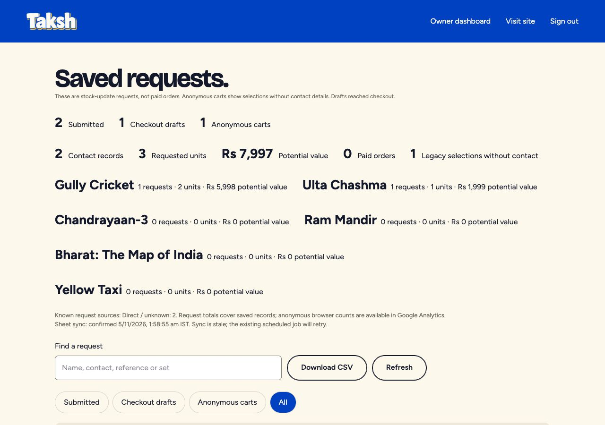
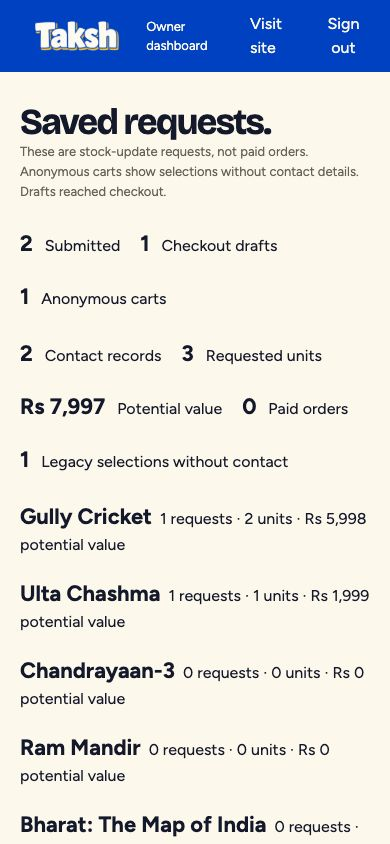

# Demand reporting follow-up —5 November2026

## Scope

Owner-contact exclusions and separation of historical selections without contact details. All records and stored prices are preserved. No public checkout change, new visitor tracker, database migration, service, payment or customer message. Owner access was verified on live v60 after the owner explicitly set a password; no credential is included here.

## Verified in isolated GitHub worktree

- Locked dependency install completed. Generated image assets were prepared before the final test run; a fresh checkout initially lacked those ignored assets.
- 75 unit tests passed, including bound SQL owner exclusions, full-history demand, legacy selection separation, Sheet retry/manual-note protection and private contact classification.
- TypeScript check passed. Full lint passed with no errors and two existing warnings (stock-notice unused prop and gallery hook dependency). No rules were weakened.
- Production build and existing performance/image budgets passed: public CSS105310bytes; all17 Gully originals byte-identical.
- Four local request-flow integrations passed: demand/auth/privacy/CSV/sync recovery; cart lifecycle; availability requests and retry idempotency; Gully quantity and server price validation. They target isolated loopback storage only. The private-contact test confirms a public response does not reveal private-list membership while the authenticated report excludes that record.
- Local D1 was initialised through the five committed migrations using explicit wrangler d1 migrations apply with --local and an ignored fixture config. No production data was copied into preview storage.
- Independent review identified a public membership leak in an earlier unshipped approach. Private matching was removed from public writes/responses, and a passing integration assertion covers it. The private setting is not serialized into the client bundle.

## Visual verification —5 November2026

- Browser connection recovered despite native Mac controls remaining unavailable. Fresh live owner sign-in succeeded using the owner-configured credential. The earlier direct scripted HTTP403 check did not replace browser verification and was not treated as a password failure.
- The initial390px test found horizontal overflow: document width688px. Existing summary/filter rows now wrap, scoped to the private dashboard with no public CSS addition. Final document width390px equals the viewport; filter targets are46px tall. Layout also stays within1440px and1280px desktop viewports, including header controls.
- Desktop capture is1280×900; phone capture is390×844. A1440px viewport was checked through element bounds; the browser's screenshot surface clipped that larger capture, so the complete1280px capture is supplied. Screenshots below contain synthetic local records only, never real customers.
- A synthetic contactless legacy selection is shown separately and does not change the2 contactable requests,3 requested units or INR7997 potential value in the test database. All retains the legacy/excluded records and shows their labels; no records were deleted.

## Release boundary

This branch is ready for review. No publish from the frozen original folder and no domain switch. The pull request must be reviewed/reconciled into the hosting migration, configured with the private INTERNAL_CONTACTS setting, and verified on its isolated Cloudflare preview before cutover. The matching bound Google script change must be applied deliberately with properties/cursor intact. The live site remains v60; this historical-reporting correction is not yet live.
